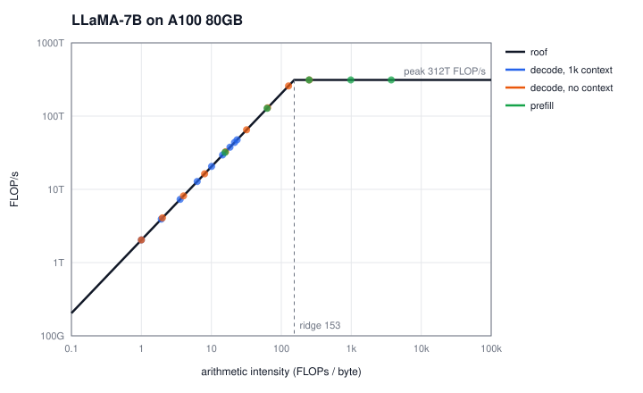
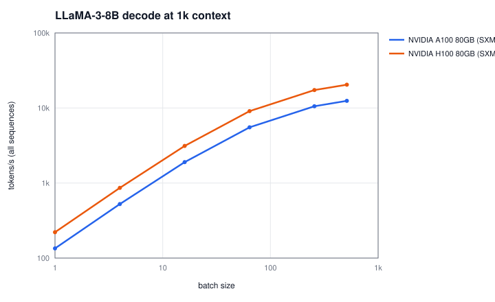
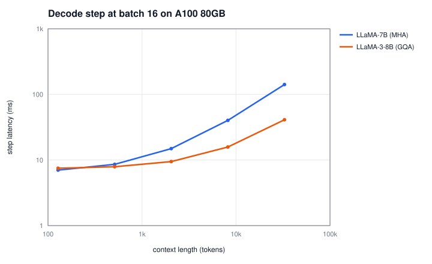
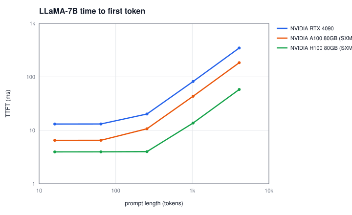
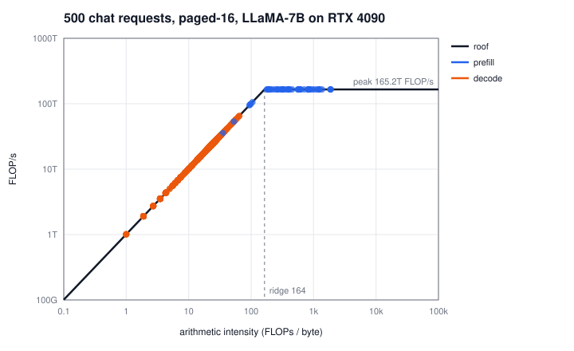

# Bandwidth, latency and roofline results

Generated by `python scripts/part3_experiments.py`. All numbers come from the analytic roofline model in `kvsim/perf.py` (ideal hardware unless stated) and, for P7-P8, from seeded Part 2 simulations. The model is described in [part3-bandwidth-roofline.md](part3-bandwidth-roofline.md).

## P1. Checks against known numbers

LLaMA-7B in FP16 (12.55 GiB of weights), one sequence, 128 tokens of context. The usual rule of thumb is that batch-1 decode runs at memory bandwidth / model size, and that a token costs about 2 FLOPs per parameter.

| gpu | bandwidth_gbs | bandwidth_over_weights_tok_s | model_tok_s | ratio | flops_over_2x_params | intensity |
|---|---|---|---|---|---|---|
| NVIDIA A100 40GB (SXM) | 1,555 | 115 | 117 | 1.01 | 0.986 | 1 |
| NVIDIA A100 80GB (SXM) | 2,039 | 151 | 154 | 1.01 | 0.986 | 1 |
| NVIDIA H100 80GB (SXM) | 3,350 | 249 | 252 | 1.01 | 0.986 | 1 |
| NVIDIA RTX 4090 | 1,008 | 74.8 | 75.9 | 1.01 | 0.986 | 1 |

The model lands within 2% of the rule of thumb on every GPU (the small gap is the KV-cache read and the embedding table, which is not streamed). One FLOP per byte is far below every ridge point (153-295 FLOPs/byte), so batch-1 decode uses under 1% of the GPU's compute.

## P2. Prefill against decode on the roofline

LLaMA-7B, FP16, A100 80GB (ridge point 153 FLOPs/byte).

| step | hbm_bytes | flops | intensity | t_memory_ms | t_compute_ms | latency_ms | bound |
|---|---|---|---|---|---|---|---|
| decode b=1 | 12.81 GiB | 13,751,549,952 | 1 | 6.74 | 0.0441 | 6.74 | memory |
| decode b=16 | 20.32 GiB | 220,024,799,232 | 10.1 | 10.7 | 0.705 | 10.7 | memory |
| decode b=128 | 76.43 GiB | 1,760,198,393,856 | 21.4 | 40.2 | 5.64 | 40.2 | memory |
| prefill 64 | 12.34 GiB | 830,281,351,168 | 62.7 | 6.5 | 2.66 | 6.5 | memory |
| prefill 512 | 12.56 GiB | 6,700,545,343,488 | 497 | 6.61 | 21.5 | 21.5 | compute |
| prefill 2048 | 13.32 GiB | 27,626,028,662,784 | 1,931 | 7.02 | 88.5 | 88.5 | compute |

Prefill reuses every weight for each prompt token, so a prompt of a few hundred tokens or more sits right of the ridge and is compute-bound (a 64-token prompt is still memory-bound). Decode does one token per sequence, so without KV traffic its intensity would equal the batch size. With 1,024 tokens of context, MHA decode never reaches the ridge: each sequence's KV read (512 MiB at 1k tokens) grows with the batch, so attention keeps the step near 1 FLOP per KV byte.

## P3. Bigger batches reuse the weights

LLaMA-3-8B (GQA, 128 KiB of KV per token), FP16, 1,024 tokens of context, A100 80GB.

| batch | latency_ms | tokens_per_s | tokens_per_s_per_seq | bytes_weights_per_token | bytes_kv_per_token | intensity | bound | fits |
|---|---|---|---|---|---|---|---|---|
| 1 | 7.43 | 135 | 135 | 13.98 GiB | 128.25 MiB | 1.03 | memory | yes |
| 4 | 7.63 | 525 | 131 | 3.49 GiB | 128.25 MiB | 4 | memory | yes |
| 16 | 8.42 | 1,901 | 119 | 894.66 MiB | 128.25 MiB | 14.5 | memory | yes |
| 64 | 11.6 | 5,525 | 86.3 | 223.67 MiB | 128.25 MiB | 42.1 | memory | yes |
| 256 | 24.2 | 10,558 | 41.2 | 55.92 MiB | 128.25 MiB | 80.5 | memory | yes |
| 512 | 41.1 | 12,448 | 24.3 | 27.97 MiB | 128.25 MiB | 94.9 | memory | no |

Weights are read once per step, so the bytes spent on weights per token fall as 1/batch while the KV bytes per token stay the same. Going from batch 1 to 64 makes each step only 1.6x slower but gives 41x the tokens. Past that, KV reads take over and the gains flatten; batch 512 no longer fits in 80 GB.

## P4. Long contexts: MHA against GQA

Decode at batch 16 on an A100 80GB.

| model | context | latency_ms | tokens_per_s | bytes_kv_per_token | fits |
|---|---|---|---|---|---|
| LLaMA-7B | 128 | 7.02 | 2,281 | 65.00 MiB | yes |
| LLaMA-7B | 512 | 8.6 | 1,861 | 257.00 MiB | yes |
| LLaMA-7B | 2,048 | 14.9 | 1,073 | 1.00 GiB | yes |
| LLaMA-7B | 8,192 | 40.2 | 398 | 4.00 GiB | yes |
| LLaMA-7B | 32,768 | 141 | 113 | 16.00 GiB | no |
| LLaMA-3-8B | 128 | 7.5 | 2,135 | 16.25 MiB | yes |
| LLaMA-3-8B | 512 | 7.89 | 2,028 | 64.25 MiB | yes |
| LLaMA-3-8B | 2,048 | 9.47 | 1,690 | 256.25 MiB | yes |
| LLaMA-3-8B | 8,192 | 15.8 | 1,013 | 1.00 GiB | yes |
| LLaMA-3-8B | 32,768 | 41.1 | 390 | 4.00 GiB | no |

The cache read grows linearly with context. LLaMA-7B's MHA cache is 4x larger per token than LLaMA-3-8B's GQA-8 cache, so LLaMA-7B at 2,048 tokens is about as slow as LLaMA-3-8B at 8,192. Neither fits 16 sequences of 32k tokens in 80 GB. (LLaMA-7B was trained for 2,048 tokens; its longer rows only show the trend.)

## P5. Time to first token

One LLaMA-7B prompt, FP16, prefilled in one pass.

| gpu | ridge_flops_per_byte | compute_bound_from_prompt | ttft_64_ms | ttft_1024_ms | ttft_4096_ms |
|---|---|---|---|---|---|
| NVIDIA RTX 4090 | 164 | 168 | 13.1 | 82 | 348 |
| NVIDIA A100 80GB (SXM) | 153 | 157 | 6.5 | 43.4 | 184 |
| NVIDIA H100 80GB (SXM) | 295 | 304 | 3.95 | 13.7 | 58.1 |

Short prompts cost the same as one decode step (the weights have to be read anyway). Once the prompt is longer than about the ridge point, prefill is compute-bound and TTFT grows linearly, then a little faster as causal attention adds P^2 work.

## P6. Quantization speeds up decode

LLaMA-7B on an RTX 4090 at 1,024 tokens of context. Decode is memory-bound, so fewer bytes means proportionally more speed.

| weights | kv | batch1_tok_s | batch32_tok_s | share_kv_traffic_batch32 | batch32_fits |
|---|---|---|---|---|---|
| fp16 | fp16 | 73.3 | 1,060 | 56.6% | no |
| int8 | fp16 | 137 | 1,341 | 71.6% | yes |
| int4 | fp16 | 227 | 1,527 | 81.5% | yes |
| int4 | int8 | 241 | 2,551 | 69.1% | yes |
| int4 | int4 | 248 | 3,688 | 55.3% | yes |

INT4 weights make batch-1 decode 3.1x faster (not 4x: the group scales, the FP16 embeddings and LM head, and the FP16 KV-cache still have to be read). At batch 32 most of the traffic is the KV-cache, so INT4 weights alone give only 1.4x; adding an INT4 KV-cache gives 2.4x more. In FP16, batch 32 at 1k tokens does not even fit in 24 GB.

## P7. A served workload in real time

The Part 2 workload (500 `chat` requests at step 0, seed 1) on LLaMA-7B / RTX 4090, with every step timed by the roofline model.

| allocator | steps | total_time_s | throughput_tok_s | decode_step_p50_ms | share_time_memory_bound | ttft_p50_ms | tpot_p50_ms | e2e_p95_ms |
|---|---|---|---|---|---|---|---|---|
| contig-max | 16,813 | 266 | 601 | 15.7 | 98.1% | 122,581 | 16.1 | 244,803 |
| contig-oracle | 8,692 | 162 | 987 | 18.4 | 95.8% | 63,917 | 19.4 | 140,660 |
| paged-16 | 4,909 | 117 | 1,365 | 23.7 | 89.0% | 39,438 | 28 | 99,853 |

Paged allocation needs 3.4x fewer steps than contig-max but gives 2.3x the throughput, not the same factor: its decode steps run bigger batches, which read more KV and take longer. Each request therefore waits longer per output token (28 against 16 ms), but far less for its first token, and the whole workload finishes much sooner. Step counts alone overstate the gain; timing the steps gives the real one. Almost all of the time is memory-bound decode.

## P8. Ideal against realistic hardware

The default model is the ideal roofline: an upper bound on speed. Real kernels reach about 70-90% of peak bandwidth and 50-70% of peak FLOP/s, and every step pays a few ms of launch and scheduling overhead. LLaMA-7B / RTX 4090, 200 `chat` requests, paged-16.

| hardware | total_time_s | throughput_tok_s | tpot_p50_ms | ttft_p50_ms |
|---|---|---|---|---|
| ideal roofline | 50 | 1,218 | 28.8 | 1,460 |
| 80% bandwidth, 60% compute | 64.6 | 943 | 37.9 | 2,433 |
| same + 2 ms per step | 69.2 | 881 | 40.1 | 2,451 |

Use `--bw-efficiency`, `--compute-efficiency` and `--step-overhead-us` to calibrate against a measured system.
